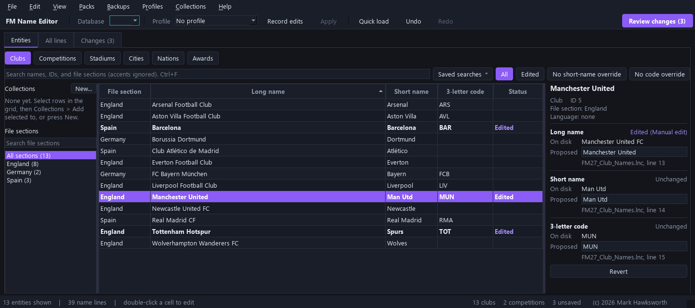
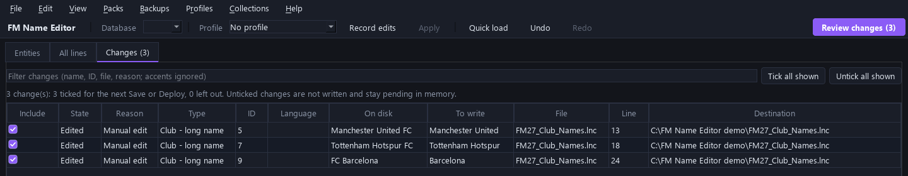
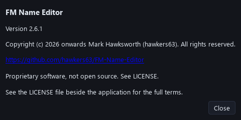
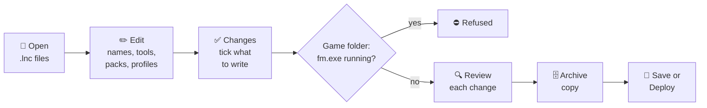

<div align="center">


# FM Name Editor

**Your spellings in Football Manager 27. Previewed, reviewed, backed up, and written back without disturbing a line you did not touch.**

A Windows desktop editor for Football Manager 27 `.lnc` name files. Change club, competition, stadium, and related spellings, carry your edits across from an older game's files by database ID, and write the file back safely.

[](https://github.com/hawkers63/FM-Name-Editor/releases/latest)
[](https://github.com/hawkers63/FM-Name-Editor)
[](https://www.python.org/)
[-41CD52?logo=qt&logoColor=white)](https://doc.qt.io/qtforpython-6/)
[](tests/test_engine.py)
[](LICENSE)

[](https://github.com/hawkers63/FM-Name-Editor/releases/latest)

<sub>
Release: 3.5
Status: released
Application on disk: 3.5
</sub>

</div>

---

## ⚽ Why FM Name Editor

Football Manager reads its club, competition, and stadium names from plain `.lnc` text files. Editing them by hand is easy to get wrong: one stray quote, a lost line ending, or a save while the game is running, and the file is damaged. Do it again after every game update and the work multiplies.

FM Name Editor turns those files into a searchable grid, keeps a record of what you changed, and treats every write as something to check first.

> [!IMPORTANT]
> **Your game files are handled with care.**
> - Lines you did not touch are written back **byte for byte**, with their encoding, byte-order mark, and line endings kept.
> - Every Save and Deploy shows a **preview and review** of each change first, and takes an **archive copy** of the files it will replace.
> - It **refuses to write into the game folder while `fm.exe` is running**, and never closes the game for you.

| Pillar | What you get |
| --- | --- |
| **Safe by design** | A review before every write, a backup with a `manifest.json` (sizes, SHA-256, encoding), files replaced one at a time with a way back if one fails |
| **Built for real files** | Both FM27 name files open in under a second; an edit or an undo takes under a tenth of a second |
| **Your spellings, kept** | Spelling profiles and name packs carry your edits across matched on command, database ID, and language |
| **Nothing hidden** | The Changes tab lists every difference from the files on disk, each with its own tick |

---

## ✨ Key features

**New in 3.5:** file pickers that start in the folder last opened from or in the selected database's `lnc\all`, up to three **favourite folders** in the File menu, **View > Show ID column** (on by default), and **Edit > Add name…** for an ID the open files do not mention. Export name pack will not save inside the game's folders. Nothing is written until Save or Deploy.

**New in 3.4:** an **Illustrative** card in the inspector (table row, scoreboard and ticker previews of the long, short and code spellings) and **Restore selected names** in the Backups window, which copies only the ticked spellings into memory as one undo step. Nothing is written until Save or Deploy.

**New in 3.2:** right-click **Select similar names**, **Edit > Selection**, **Batch rename selected** (Ctrl+B), **Tools > Harmonise terminology**, and a **Command palette** (Ctrl+Shift+P). Select the visible rows you want, open Batch rename, choose the fields and transformation, and review the inclusion ticks before Apply. Apply changes memory as one undo step; Save or Deploy still reviews and writes the changes.

**New in 3.3:** shared-word selection from the right-click menu when two or more rows are selected, a batch recipe taken from the selection as the Ctrl+B suggestion, and **pinned spelling pairs** &mdash; pin pairs you use (Rovers / Rvrs, Borough / Boro) and Harmonise lists them under the built-ins, Select similar offers *Also select the other form*, and Ctrl+B may suggest them. Pins live in `state\rules.json`; Save and Deploy never touch the list, and deleting a pin never renames a club.

| | |
| --- | --- |
| 🧩 **Entities grid** | A club or competition is one row: long name, short name, and code. Tabs for clubs, competitions, stadiums, cities, nations, and awards; **All lines** keeps the full table |
| 🔎 **Search that forgives accents** | Search and filter by file section, type, edited rows, **No short-name override**, or **No code override**. Keep searches under a name |
| 🗂️ **Inspector panel** | For each field: the text on disk above the text to write, whether it is unchanged, edited, or added, and the file and line |
| ✅ **Changes tab and review** | Every pending change with a tick. Untick one to leave it out of the next write; it stays pending in memory |
| ↩️ **Undo and Redo** | Whole operations, one step each: a bulk tool, a name pack, a profile, a restore, or a Revert. Undo goes back past a Save |
| 📝 **Spelling profiles** | Record your preferred spellings, then **Apply...** them again when the game's files change. Only names the game has not changed are ticked for you |
| 📦 **Name packs** | Export and import spellings as JSON or CSV, with a preview first |
| 🧹 **Bulk tools and Replace** | Preview an affix strip, a competition sponsor clean, title casing, or a regular-expression Replace before anything changes |
| 🗄️ **Backups window** | Browse the archive, compare a backed-up file with the open one, and put that copy back into the editor |
| 🔐 **Licensing files** | Rename the four name-mask files to `.disabled`, or restore them. Their contents are never edited |
| ⭐ **Collections** | Keep your own sets of rows, such as "My save" or "Names to review", stored locally and never in the name files |
| 🖥️ **Fits your screen** | Menus with keys beside every action (F1 lists them all), and a window that fits at 100%, 125%, and 150% scaling |

---

## 📸 Screenshots

<p align="center">
  
  <br><sub><b>Entities.</b> Edited names stand out, and the panel on the right shows the text on disk above the text to write.</sub>
</p>

<p align="center">
  
  <br><sub><b>Changes.</b> Every difference from the file on disk, with its own tick. Untick a row to leave it out of the next Save or Deploy.</sub>
</p>

<p align="center">
  
  <br><sub><b>Help > About.</b> The version, the copyright, and a link to this repository.</sub>
</p>

<p align="center"><sub>Shown with a small sample file, not the game's own files.</sub></p>

---

## 🚀 Quick start

### Option 1: download the executable

1. Download `FM Name Editor.exe` from the [latest release](https://github.com/hawkers63/FM-Name-Editor/releases/latest). GitHub saves it as `FM.Name.Editor.exe`.
2. Put it in a folder of its own. Its `backups`, `profiles`, and `state` folders sit beside it.
3. Double-click it. No Python install is needed.

### Option 2: run from source

Double-click `FM Name Editor.bat`, or drop `.lnc` files onto that launcher.

The launcher uses `python` on PATH when it can, and otherwise:

`C:\Users\Administrator\AppData\Local\Programs\Python\Python311\python.exe`

If PySide6 is missing, the launcher offers to install it for that interpreter. You can also start the script yourself:

```
python fm_name_editor.py
python fm_name_editor.py "FM27_Club_Names.lnc" "FM27_Fix.lnc"
```

Requires Python 3.11 or later and PySide6. No other packages.

---

## 🔄 How an edit reaches the game



Open with **Quick load**, **File > Open files**, or by dropping `.lnc` files on the launcher. **Undo** and **Redo** work on whole operations at any point, even after a Save. A write into the game folder is refused while Football Manager runs; otherwise the review lists every change and destination file, a backup copy is taken first, and the files are replaced one at a time, put back from that copy if one fails.

---

## 🛠️ Build a Windows executable

A tracked PyInstaller spec and launcher build a one-file, windowed `FM Name Editor.exe` from the source. Install PyInstaller once:

```
python -m pip install pyinstaller
```

Then double-click `build_exe.bat`, or run it from a terminal:

```
build_exe.bat
```

It finds `python` on PATH (with the same fallback as the launcher), runs PyInstaller against `FM Name Editor.spec`, and prints where the exe landed. The result is `dist\FM Name Editor.exe`: a windowed (no console) build that carries `icon\football.ico` and a Windows version resource (product name, file and product version from `VERSION`, LegalCopyright with the notice at the foot of this file).

The exe stands on its own: the backups, profiles, and state folders sit beside it, so it works wherever it is unpacked. PyInstaller is a build tool only; the runtime still needs only PySide6.

`/build/` and `/dist/` are kept out of the repository; the exe itself is never committed. Each release's exe is attached to its GitHub Release.

---

## 🎮 Game files and safety

On this PC the FM27 name files are:

`D:\Steam\steamapps\common\Football Manager 27\shared\data\database\db\2700\lnc\all\`

Use **Quick load**, **File > Open files**, or drop `.lnc` files onto the launcher. Quick load still opens the two UTF-8 name files in `lnc\all`. Open `lnc\greek\person_name_changes.lnc` yourself when you want the Greek ending rules. That file is UTF-16 and the editor keeps it that way.

> [!WARNING]
> Close Football Manager before Save into the game folder, Deploy, or a licensing toggle. The editor refuses while `fm.exe` is running. It does not close the game for you.

Lines that are not simple name commands are kept as they are. That includes comments, blank lines, player-name lines, and anything the parser does not recognise.

Game data and backups do not belong in this repository.

---

## 📜 Release history

| Release | Date | Highlights |
| --- | --- | --- |
| [**3.5**](https://github.com/hawkers63/FM-Name-Editor/releases/tag/v3.5) | 22&nbsp;Nov&nbsp;2026 | 📂 Useful start folders and favourites, the ID column on the entity grid, and Add name |
| [**3.4**](https://github.com/hawkers63/FM-Name-Editor/releases/tag/v3.4) | 21&nbsp;Nov&nbsp;2026 | 🖼️ Illustrative previews in the inspector, and per-name restore from a backup |
| [**3.3**](https://github.com/hawkers63/FM-Name-Editor/releases/tag/v3.3) | 21&nbsp;Nov&nbsp;2026 | 📌 Shared-word selection, a Batch rename suggestion from the selection, and pinned spelling pairs |
| [**3.2**](https://github.com/hawkers63/FM-Name-Editor/releases/tag/v3.2) | 20&nbsp;Nov&nbsp;2026 | ✏️ Select similar names, Batch rename (Ctrl+B) as one undo step, Harmonise terminology, and a command palette |
| [**3.1**](https://github.com/hawkers63/FM-Name-Editor/releases/tag/v3.1) | 18&nbsp;Nov&nbsp;2026 | 🎨 Named colours and type badges, the rest of the saved Bulk-tools rules, a user guide, and the version in the header |
| [**3.0**](https://github.com/hawkers63/FM-Name-Editor/releases/tag/v3.0) | 18&nbsp;Nov&nbsp;2026 | 🔄 Carry a profile's spellings forward when the game's database updates; an override inspector, review hints, saved rules, and a sharper icon |
| [**2.6.1**](https://github.com/hawkers63/FM-Name-Editor/releases/tag/v2.6.1) | 17&nbsp;Nov&nbsp;2026 | 🔗 The public repository link in **Help > About** and the status bar; a steadier speed test |
| [**2.6**](https://github.com/hawkers63/FM-Name-Editor/releases/tag/v2.6) | 17&nbsp;Nov&nbsp;2026 | 🏷️ Public-ready: copyright inside the editor, its own icon, a Windows `.exe` with each release |
| [**2.5**](https://github.com/hawkers63/FM-Name-Editor/releases/tag/v2.5) | 12&nbsp;Nov&nbsp;2026 | 🩹 Corrective: six faults from the review of 2.4 put right, including a licensing safety fix |
| [**2.4**](https://github.com/hawkers63/FM-Name-Editor/releases/tag/v2.4) | 12&nbsp;Nov&nbsp;2026 | ⚡ Opens in under a second; menus, inspector panel, collections, saved searches, 100–150% scaling |
| [**2.3**](https://github.com/hawkers63/FM-Name-Editor/releases/tag/v2.3) | 11&nbsp;Nov&nbsp;2026 | 📝 Spelling profiles, the Changes tab, a review before every write, Undo and Redo |
| [**2.2**](https://github.com/hawkers63/FM-Name-Editor/releases/tag/v2.2) | 11&nbsp;Nov&nbsp;2026 | 🛡️ Safety: guarded saves, files replaced one at a time with a way back, self-describing backups |
| [**2.1**](https://github.com/hawkers63/FM-Name-Editor/releases/tag/v2.1) | 11&nbsp;Nov&nbsp;2026 | 📦 Name packs (JSON/CSV), regular-expression Replace, the Backups window, the Greek UTF-16 file |
| [**2.0**](https://github.com/hawkers63/FM-Name-Editor/releases/tag/v2.0) | 11&nbsp;Nov&nbsp;2026 | 🧩 The Entities grid, accent-insensitive search, Quick load, Deploy, bulk tools, licensing toggle |

Full version notes are in [CHANGELOG.md](CHANGELOG.md). Open a release below for its summary.

<details>
<summary><b>What 3.5 adds</b> &nbsp;·&nbsp; 22&nbsp;Nov&nbsp;2026</summary>

3.5 adds file pickers that start in a useful folder, up to three favourite folders, the ID column on the entity grid, and Edit > Add name for an ID the open files do not mention.

- **File pickers start somewhere useful.** File > Open files opens in the folder you last opened files from, or else in `lnc\all` of the selected database. Import older edits, Import name pack and Export name pack start by the same rule. When that folder is missing, the status bar names it and the picker opens in your user folder.
- **Three favourite folders.** File > Favourite folders… keeps up to three folders, listed in the File menu under "Name files in the selected database". They are stored in `state\settings.json`; a bad entry is ignored, and a damaged file is left byte for byte.
- **A name pack is never saved inside the game's folders.** Export name pack refuses a path in the game's database folder or in a Steam library. Only Save and Deploy write there, after a backup.
- **The ID column, on by default.** View > Show ID column is shown by default and remembered with the view, revising the earlier rule that hid it. The column is sized from its text and sorts by number, with empty IDs last. The sorted heading is now bold on both grids.
- **Edit > Add name….** Adds name lines for an ID the open files do not mention, at the end of the file under `#Imported by FM Name Editor`, as one undo step. An ID already open selects that row and adds nothing. Nothing is written until Save or Deploy.

</details>

<details>
<summary><b>What 3.4 adds</b> &nbsp;·&nbsp; 21&nbsp;Nov&nbsp;2026</summary>

3.4 adds an illustrative preview card in the inspector and per-name restore in the Backups window.

- **Illustrative previews in the inspector.** A collapsible **Illustrative** card shows the selected entity's long, short and code spellings as a **table row**, a **scoreboard**, and a **ticker** that cycles every three seconds. Absent overrides are shown honestly. The card updates only from the selection and its edits; it does not read files while painting. It folds itself away when the inspector is narrower than 240 px or the window is shorter than 560 px, and opens again when there is room. The ticker runs only while the card is expanded, shown and has a selection, and stops when the window closes.
- **Per-name restore in Backups.** The Backups window has a **Restore** tick on each differing name. **Restore selected names** copies only the ticked spellings into memory as one undo step. Each restored name is marked pending until Save or Deploy. Whole-file restore is unchanged. A stale comparison is refused, and the original backup file is never modified.

</details>

<details>
<summary><b>What 3.3 adds</b> &nbsp;·&nbsp; 21&nbsp;Nov&nbsp;2026</summary>

3.3 adds shared-word selection, a Batch rename suggestion taken from the rows you have selected, and pinned spelling pairs you can reuse.

- **Select similar leads with the words the rows already share.** With two or more rows selected, the right-click menu starts with the significant words those rows have in common, most shared first, with a count of visible and total matches. Words that would only reselect the current rows are left off. A single-row right-click behaves as it did in 3.2.
- **Batch rename opens aimed at the selection.** Ctrl+B chooses the word shared by the most of the selected names and fills the preview with the matching football preset ("United → Utd") as a suggestion you can clear or change. The suggestion line states its basis in plain words. A short-name row that already reads the other form starts unticked with the reason on the row; a short name with different wording is left alone. Missing short names and codes are not invented.
- **Pinned spelling pairs.** Beside the built-in pairs (United / Utd, City / Cty, Saint / St. / St and the rest), you can pin pairs you actually use (Rovers / Rvrs, Borough / Boro) from **Tools > Harmonise terminology** or from a Batch rename preview. Pins live in `state\rules.json`. Save and Deploy never touch the list, and deleting a pin never renames a club.
- **Pins show up in the three places that already exist.** **Select similar names** offers *Also select the other form* with the same visible and hidden counts. **Harmonise** lists each pinned pair under the built-ins with a count for each form. **Ctrl+B** may offer a pinned pair as the suggested preset when the selection shares one side of it.
- **Applying a pair still goes through Batch rename.** Every row can be unticked, one Undo takes the whole run back, and nothing is written until Save or Deploy. Stale previews are still refused.
- **Targeted token-index refresh.** After a single edit the token index now refreshes only the entity that changed, so the right-click menu stays inside the one-second rule on a large file. Edit, Undo and Redo keep the index equal to a fresh scan.

</details>

<details>
<summary><b>What 3.2 adds</b> &nbsp;·&nbsp; 20&nbsp;Nov&nbsp;2026</summary>

3.2 adds smart selection and batch renaming, so a change to many names is one reviewed step.

- **Select similar names.** Right-click an entity to select rows that share a word from its names, with a count for each match. With two or more rows selected, the menu leads with the words those rows already share, most shared first, and leaves off any word that would only reselect the current rows. The current filters are kept and hidden rows stay out.
- **Edit > Selection.** Select by word (Ctrl+Shift+W), by wildcard or regular expression (Ctrl+Shift+S or Ctrl+Shift+F), or by the same file section (Ctrl+Alt+S); **Invert selection** is Ctrl+Shift+I and **Clear selection** is Ctrl+D.
- **Batch rename selected (Ctrl+B).** Replace text, whole words, prefixes and suffixes, football abbreviation presets, or a regular expression with capture groups, with case, accent and capitalisation options. The dialogue opens aimed at the selection: when the selected names share a word that is one side of a built-in pair, it suggests the preset ("United → Utd") and fills the preview, stating its basis in plain words — you can clear it or type your own. A short-name row that already reads the other form starts unticked with a reason. A live preview has a tick on every row, and **Apply** changes only the ticked rows. Missing overrides are not invented.
- **One undo step, memory only.** The whole preview is checked before any line changes; a stale preview or an invalid result is refused. One Undo takes back the batch, and nothing is written until Save or Deploy.
- **Tools > Harmonise terminology.** Lists full and abbreviated club spellings in the loaded files with a count for each form. You choose the direction, then review it in Batch rename.
- **Command palette (Ctrl+Shift+P).** Search menu commands, saved searches and collections by text, or select visible names by a word.
- **Status-bar selection button.** While several entity rows are selected, a button in the status bar opens Batch rename. F1 stays **Keyboard shortcuts**, which now lists the Selection keys too.

</details>

<details>
<summary><b>What 3.1 adds</b> &nbsp;·&nbsp; 18&nbsp;Nov&nbsp;2026</summary>

3.1 finishes the saved Bulk-tools rules and makes a visual pass of the window.

- **Every Bulk-tools rule is saved.** **Edit > Bulk tools...** now starts from all of your rules in `state\rules.json`, not only the sponsor list: the affix set, the small words, a casing choice, the scope, and a never-change list. **Save as default rules** keeps everything on screen. A rules file from 3.0 still loads, using the defaults for anything new.
- **Casing.** The new *Also single long capital words* option turns "Club ATLETICO Madrid" into "Club Atletico Madrid" and leaves short forms such as FC, AFC, and USA alone.
- **Scope.** A run covers the current filter, the whole family, or the selected rows. Each option shows its count, and an empty one cannot be picked.
- **A tick on every preview row.** Rows start ticked, there is **Tick all** / **Untick all**, and the button reads **Apply N ticked**. Applying is one undo step and writes nothing until Save or Deploy.
- **Never change.** Select preview rows and choose **Never change selected rows** to keep those entities out of every bulk run.
- **Named colours and type badges.** Every colour is defined once, by name. **All lines**, **Changes**, and **Review changes** show a small coloured square for each line's family, next to the type's own words.
- **Keys and menus.** **Deploy** is Ctrl+Shift+D, **Exit** is Ctrl+Q, **F4** shows or hides the inspector (and the choice is remembered), **View > Reset column widths** sizes every column to its text again, and **Help > User guide** explains the workflow in seven short sections.
- **The line in the inspector.** Each field shows the raw line as Save would write it. The header's product label shows the version.

</details>

<details>
<summary><b>What 3.0 adds</b> &nbsp;·&nbsp; 18&nbsp;Nov&nbsp;2026</summary>

3.0 begins the update-migration workflow: when Football Manager releases a new database, a profile can carry its spellings forward, and the database selector names the version it is looking at.

- **Database identity in the selector.** The **Database** list reads the version folder's own XML and labels it, for example, "FM27 27.0.0 (2700)". A folder without that file, or with a malformed one, is shown by its folder name as before.
- **Migrate from new files.** **Profiles > Migrate from new files...** compares every spelling in the chosen profile against the files you have just loaded from a new version of Football Manager. Rows that still match the recorded baseline are pre-ticked; a name the game has changed since, a key that is no longer there, or an unsaved edit is left unticked, with a note. Applying the ticked migration is one step, so Undo takes it back, and the writes go through Review changes as usual.
- **Show overrides across files.** Right-click a row and choose **Show overrides across files...** to list every matching name line in the database folder's `.lnc` files. Lines for the same type and language are marked as agreeing or disagreeing. The list does not claim a load order.
- **Review hints.** An amber note appears under a field the editor has flagged. The first is club 740, "Wolverhamption". It is a note only; nothing is applied.
- **Saved Bulk-tools rules.** The sponsor box in **Edit > Bulk tools...** starts from `state\rules.json`, and **Save as default rules** keeps what you typed. A damaged file is named in the status bar and left as it is.
- **A quicker Import older edits.** Reading and comparing now runs in the background (about three quarters of a second with both FM27 files), so the window stays responsive.
- **A sharper icon.** The application icon is now rendered from the vector artwork at 16 to 256 pixels.

</details>

<details>
<summary><b>What 2.6.1 adds</b> &nbsp;·&nbsp; 17&nbsp;Nov&nbsp;2026</summary>

2.6.1 is a small follow-up to 2.6. The editing workflow is unchanged.

- **A link to the repository.** **Help > About FM Name Editor** shows https://github.com/hawkers63/FM-Name-Editor directly beneath the copyright line; click it to open the page in your browser.
- **The status-bar tooltip names it too.** Hovering the short copyright shows the full copyright, the repository address, and the LICENSE pointer.
- **A steadier speed test.** The one-second timing check re-measures once after a single slow step caused by a busy PC, so a passing spike no longer fails the suite. A real slowdown still fails.

</details>

<details>
<summary><b>What 2.6 adds</b> &nbsp;·&nbsp; 17&nbsp;Nov&nbsp;2026</summary>

2.6 gets the editor ready for a public repository. The editing workflow is unchanged; it adds the copyright notice inside the program, its own icon, and a Windows executable for each release.

- **About FM Name Editor.** **Help > About FM Name Editor** shows the version and the copyright: "Copyright (c) 2026 onwards Mark Hawksworth (hawkers63). All rights reserved." Directly beneath it, a clickable link to the public repository at <https://github.com/hawkers63/FM-Name-Editor> opens in the default browser. The software is proprietary, not open source; see [LICENSE](LICENSE).
- **The copyright in the status bar.** A short "(c) 2026 Mark Hawksworth" sits beside the metrics, with the full line, the repository URL, and the LICENSE pointer in its tooltip.
- **Its own icon.** The football icon, in sizes from 16 to 256 pixels, is on every window and dialog and on the exe.
- **A Windows executable.** From 2.6, each GitHub Release carries `FM Name Editor.exe`, a one-file windowed build that needs no Python install. Its backups, profiles, and state folders sit beside the exe, so give it a folder of its own. See **Build a Windows executable** above to build it yourself.

</details>

<details>
<summary><b>What 2.5 changes</b> &nbsp;·&nbsp; 12&nbsp;Nov&nbsp;2026</summary>

2.5 is a corrective release. Nothing new to learn; it puts right six faults found in 2.4, and it ships on its own so that the licensing safety fix does not wait for 3.0.

- **Licensing looks for the game again after you answer.** The licensing toggle checks for a running copy of Football Manager before its question and again after Yes, the same as Save and Deploy. If the game is running by then, it stops with "Nothing was renamed". If that second check cannot be made, it asks "Have you closed Football Manager?" with No as the default, rather than reusing your earlier answer.
- **One licensing toggle at a time.** Only one toggle runs at a time, and closing the Licensing window (Close, Esc, or the title-bar button) cancels one that is still waiting. The rename does exactly the disable or restore you confirmed; if the file changed in the meantime, it stops instead of renaming it back.
- **Profile Apply checks every line it would change.** Where a name is on more than one line, **Apply...** now checks each line it would change, in any order and across both files, and the note names the file and line of each problem. Lines that already have your spelling are left as they are, because Apply would not change them anyway.
- **A wrong value no longer stops the window opening.** A value of the wrong type in `state\settings.json` is ignored. A collections file with the same fault is named in the Collections panel and left alone.
- **A damaged settings file is named and left alone.** If `state\settings.json` cannot be read, the status bar names it and the file is left exactly as it is, instead of being quietly written over. Nothing is saved for the rest of that run, even if you fix the file meanwhile; to recover, fix or move the file and restart the editor.
- **Refused text stays in the inspector.** Text that cannot be a name now stays, with its reason, through edits to other fields, reloads, and Undo.
- **No file actions during background work.** **Export pack**, the profile **New**, **Rename**, and **Delete** actions, and **Collections > Add selected to** are switched off while files are opened, a backup is read, or the game is checked.

</details>

<details>
<summary><b>What 2.4 adds</b> &nbsp;·&nbsp; 12&nbsp;Nov&nbsp;2026</summary>

- **A window that answers at once.** With both FM27 name files open, opening them took about ten seconds, and so did every Save, Deploy, restore, bulk step, or added field. Now opening takes under a second, an edit or an undo under a tenth, and a Save, review included, about half a second. **Open**, **Quick load**, reading a backup to restore, and the check for a running copy of Football Manager run in the background. The window stays drawn, with the grids and every action that opens, changes, or writes files switched off until the work finishes.
- **Menus and one top row.** File, Edit, View, Packs, Backups, Profiles, Collections, and Help hold every action, with its keys beside it (**Help > Keyboard shortcuts**, or F1, lists them all). The top row keeps the database, the profile with **Record edits** and **Apply...**, **Quick load**, **Undo**, **Redo**, and **Review changes**, which shows how many changes are pending and opens the review before a Save (Ctrl+S).
- **Names get the room.** The grid is sorted by long name; click a heading to sort by it. The ID column has moved to the panel on the right, and the File section column hides while one section is chosen.
- **The panel on the right shows both spellings.** For each field: the text on disk above the text to write, whether it is unchanged, edited, or added and by which tool, and the file and line. Text that cannot be a name stays where you typed it with the reason beside it; Esc puts back the name.
- **Your own collections.** Select rows and choose **Collections > Add selected to** (or right-click) to keep sets such as "My save" or "Names to review". They are listed above the file sections with a ★ in cyan, and live in the local `state\collections.json`, never in the name files.
- **Saved searches and a section search.** **Saved searches** keeps a search under a name. A box above the file sections narrows that long list as you type.
- **It remembers how you left it.** Window size and place, tab, family, filter, both sort orders, the column widths you set yourself, and the panes come back next time. Since 2.5, a damaged `state\settings.json` is named in the status bar and left alone.
- **Fits 100%, 125%, and 150% scaling.** At 150% the window now fits the screen instead of running off the bottom, keyboard focus shows as a cyan outline (it was invisible), and the include tick's empty box is clearly visible.
- Keys: F2 edits a cell, Ctrl+Shift+C goes to Changes, Ctrl+Z and Ctrl+Y undo and redo. Double-click a change to see its line.

</details>

<details>
<summary><b>What 2.3 adds</b> &nbsp;·&nbsp; 11&nbsp;Nov&nbsp;2026</summary>

- **Spelling profiles.** A profile keeps your preferred spellings in the local `profiles` folder, each with the name the game file had when you recorded it. Save and Deploy never change a profile. When the game's files change, **Apply...** offers your spellings again and ticks only those whose name the game has not changed since. Since 2.4 the profile selector, **Record edits**, and **Apply...** sit in the top row, and New, Rename, and Delete are in the **Profiles** menu.
- **The Changes tab** lists every difference between the open files and the files on disk: the text on disk, the text to write, whether the line is edited, added, restored, or removed, which tool changed it, and the file and line. Each change has a tick.
- **Review changes before every write.** Save and Deploy both show the changes, where each file goes, the backup folder, whether the game is running, and any file that changed on disk since the editor read it. An unticked change is left out of the write and stays pending. A file whose bytes would not change is not written. Save into the game folder is the same operation as Deploy, and the review says so.
- **Undo and Redo** for whole operations: Ctrl+Z and Ctrl+Y, or the **Edit** menu, which names the step. A bulk tool, a name pack, a profile, a restore, or a Revert undoes as one step, and undo goes back past a Save or Deploy. Undo changes memory only; the next Save or Deploy writes the result.

</details>

<details>
<summary><b>What 2.2 changes</b> &nbsp;·&nbsp; 11&nbsp;Nov&nbsp;2026</summary>

2.2 is a safety release. Nothing new to learn; the editor is more careful about every file it writes.

- **Save into the game folder is guarded like Deploy.** Save, Deploy, and the licensing toggle all refuse while Football Manager is running, and each one names the exact files before it writes. If the editor cannot tell whether the game is running, it says so and the answer defaults to No.
- **Files are replaced one at a time, with a way back.** Each file is written to a temporary file beside it and swapped in, in one step. If a later file fails, the files already replaced are put back from the backup copy, and a message lists where every file stands. A set of files is not one atomic step, and the editor does not claim it is.
- **A file changed by another program is not overwritten.** If a name file changed on disk after the editor opened it, Save and Deploy stop without writing and tell you how to carry your edits across: export them as a name pack, open the files again, and import the pack.
- **Unsaved means the bytes differ.** The editor compares what it would write with the file on disk, so the close prompt cannot be skipped by an edit and a revert. A restored backup stays pending until you Save or Deploy it.
- **Backups describe themselves.** Each backup folder holds a `manifest.json` with the operation, the time, the database folder, and each file's original path, size, SHA-256, encoding, and how the write ended. The **Backups** window matches a copy to the open file by its original path, and reports name differences and byte-identical files separately.
- **Checked fields and plainer labels.** A pack or older file cannot slip a quote or line break into a new line. The filters read **No short-name override** and **No code override**, and the section column is **File section**: the comment heading a row sits under, not a reliable country.

</details>

<details>
<summary><b>What 2.1 adds</b> &nbsp;·&nbsp; 11&nbsp;Nov&nbsp;2026</summary>

- **Export pack** and **Import pack** move spellings as JSON or CSV, matched on command, database ID, and language. A preview comes first.
- **Replace** finds a regular expression in one section, or in all sections, and shows the before and after list before it changes anything.
- **Backups** lists the archive, compares a backed-up name file with the open one, and can put that copy back into the editor. Save or Deploy writes it.
- The Greek person-name file (`lnc\greek\person_name_changes.lnc`) opens as UTF-16. Its ending rules are on **All lines**, not on the entity grid.

</details>

<details>
<summary><b>What 2.0 does</b> &nbsp;·&nbsp; 11&nbsp;Nov&nbsp;2026</summary>

- **Entities** is the first tab. A club or competition is one row: long name, short name, and code. **All lines** keeps the original table.
- Search ignores accents. Filter by file section, type, edited rows, **No short-name override**, or **No code override**. An absent override is not an error; the game may supply that name itself.
- Double-click a cell to edit it, or press F2. Filling an empty short name or code adds one line next to its sibling.
- **Quick load** opens the two UTF-8 name files in the selected database folder (`2700` on this PC).
- **File > Deploy to FM27** writes those files into `lnc\all` after copying the current game files into `backups`. Save of a file outside the game tree still writes a `.bak` beside it.
- **File > Licensing files** can rename the four name-mask files to `.disabled`, or restore them. It does not edit their contents. Other licensing files are listed and left alone.
- **Edit > Bulk tools** preview an affix strip, a competition sponsor clean, or title casing, then apply the preview in memory.
- Import older edits matched on command, database ID, and language. A stock rename between versions is not ticked for you.

</details>

---

## 🧭 What's next

- **Release 3.6:** a visible search scope with one click to search all sections, a character-length gauge with a truncation preview, and faster keyboard movement between rows.

The detailed roadmap and working notes stay on the developer's PC and are not part of the public repository.

---

## ©️ Copyright and licence

Copyright (c) 2026 onwards Mark Hawksworth (hawkers63). All rights reserved.

This is **proprietary software, not open source**. No open-source or permissive licence is granted, and the public source code does not grant one. See [LICENSE](LICENSE) for the terms.

The public repository is at <https://github.com/hawkers63/FM-Name-Editor>; **Help > About FM Name Editor** shows the same link in the editor.

Football Manager is a trademark of Sports Interactive Limited. This project is a personal tool. It is not affiliated with Sports Interactive or Sega.
